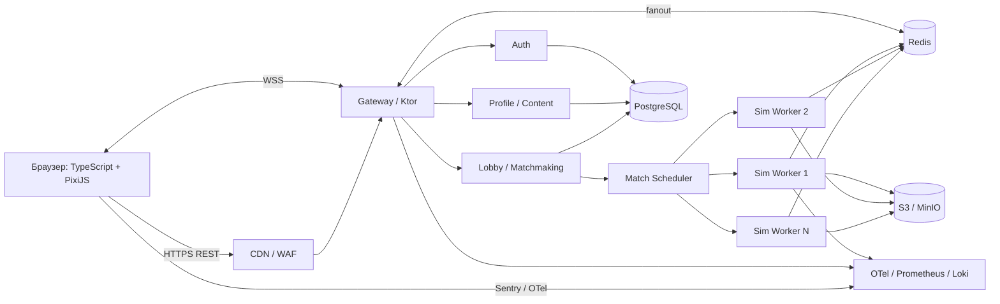
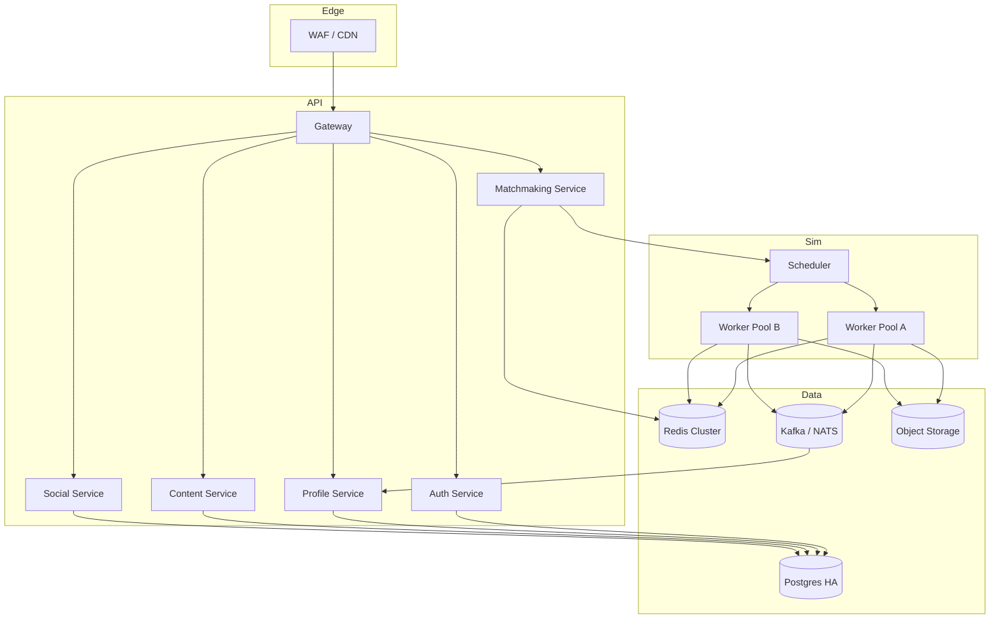
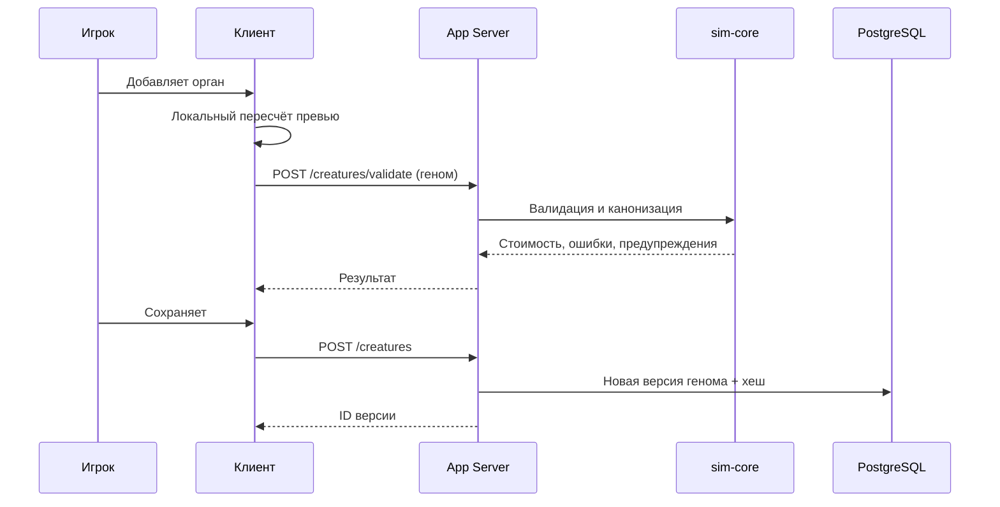
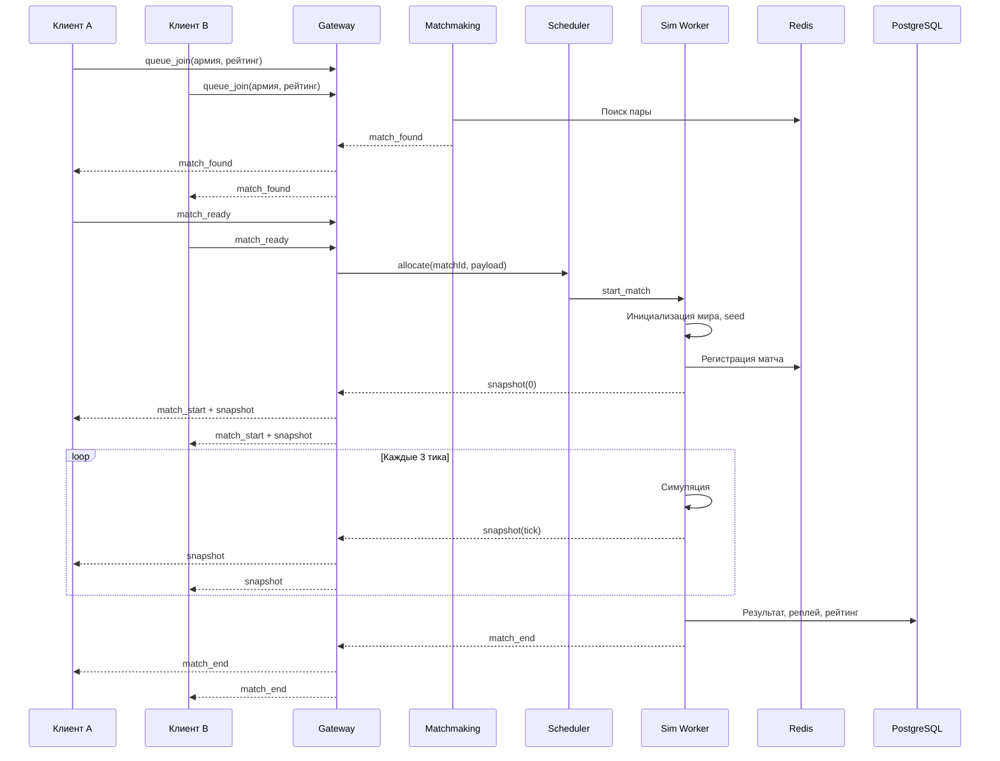

# 03. Архитектура

## 3.1. Обзор

Система состоит из трёх крупных частей:

1. **Браузерный 2D-клиент** — конструктор, планировщик, зрительский режим, реплеи.
2. **Сервер приложений** — API, аккаунты, контент, матчмейкинг, социальные функции.
3. **Симуляционный кластер** — детерминированные матчи, боты, headless-турниры.

Клиент не является авторитетным. Всё, что влияет на исход боя, вычисляется на сервере. Клиент отправляет только предбоевые намерения (геном, поведение, армию, расстановку) и команды лобби.

## 3.2. Архитектурный стиль

### 3.2.1. MVP: модульный монолит + выделенные sim-worker

- **App-сервер**: один деплой Ktor с модулями `auth`, `profile`, `content`, `lobby`, `matchmaking`, `social`, `admin`. Модули общаются через интерфейсы, а не напрямую через БД друг друга.
- **Sim-worker**: отдельный процесс/деплой, в котором живут матчи. Может масштабироваться независимо.
- **Gateway** на MVP совмещён с app-сервером; при росте выделяется.
- **Redis** — эфемерное состояние: сессии, очередь, реестр матчей, pub/sub для fanout.
- **PostgreSQL** — источник истины для аккаунтов, контента, результатов, экономики.
- **S3/MinIO** — реплеи, аватары, экспортированные геномы, архивы логов.

### 3.2.2. Почему не микросервисы сразу

- Маленькая команда, высокая скорость изменений.
- Симуляция и контент тесно связаны; раннее разделение увеличит стоимость.
- Границы модулей проектируются так, чтобы выделение было механическим.
- Симуляция уже выделена в отдельный процесс, потому что у неё другой профиль нагрузки.

### 3.2.3. Целевая топология после роста

## 3.3. Компоненты

### 3.3.1. Клиент

| Компонент | Ответственность |
|---|---|
| `AppShell` | Роутинг, аутентификация, загрузка ассетов, обработка ошибок |
| `Lab` | Биоконструктор, превью, валидация, расчёт стоимости |
| `BehaviorEditor` | Граф поведения, параметры, компиляция в JSON |
| `ArmyPlanner` | Состав армии, расстановка, анализ |
| `Lobby` | Очередь, подтверждение, чат |
| `Spectator` | Рендер матча, камера, инспектор, события |
| `Replay` | Воспроизведение, таймлайн, анализ |
| `Profile` | Статистика, коллекция, настройки |
| `Store` | Косметика, валюта, покупки |
| `Net` | REST/WS клиенты, реконнект, очереди сообщений |
| `Render` | PixiJS-сцена, слои, интерполяция, эффекты |
| `Telemetry` | События, ошибки, производительность |

### 3.3.2. Сервер приложений

| Модуль | Ответственность | Хранилище |
|---|---|---|
| `auth` | Регистрация, вход, токены, OAuth, 2FA | PostgreSQL, Redis |
| `profile` | Профиль, статистика, коллекция, настройки | PostgreSQL |
| `content` | Каталог органов, шаблоны, карты, ruleset | PostgreSQL, кэш |
| `lab` | Валидация и канонизация геномов, расчёт стоимости | PostgreSQL, sim-core |
| `army` | Армии, версии, расстановка | PostgreSQL |
| `lobby` | Очередь, подтверждение, комнаты, чат | Redis, PostgreSQL |
| `matchmaking` | Рейтинг, подбор, боты | Redis, PostgreSQL |
| `match` | Жизненный цикл матча, выдача worker, результат | Redis, PostgreSQL |
| `social` | Друзья, жалобы, блокировки | PostgreSQL |
| `admin` | Модерация, контент, флаги, аудит | PostgreSQL |
| `telemetry` | Приём событий, агрегаты | ClickHouse/Postgres, OTel |
| `replay` | Метаданные, выдача, шаринг | PostgreSQL, S3 |

### 3.3.3. Симуляция

| Компонент | Ответственность |
|---|---|
| `sim-core` | Чистая детерминированная логика: мир, существа, бой, поведение |
| `sim-content` | Загрузка и валидация каталога, формул, карт |
| `sim-runtime` | Тик-луп, матч-актор, снапшоты, события |
| `sim-bot` | Серверные архитекторы и боты существ |
| `sim-harness` | Headless-турниры, ресимуляция, проверка детерминизма |
| `sim-replay` | Формат реплея, запись, чтение, хеширование |

## 3.4. Потоки данных

### 3.4.1. Создание твари

Правила:

- Клиент считает превью для отзывчивости, но сервер пересчитывает всё авторитетно.
- Сервер канонизирует JSON (порядок ключей, нормализация чисел) и считает хеш.
- Сохранённая версия неизменяема. Правка создаёт новую версию.
- Армия ссылается на конкретные версии геномов.

### 3.4.2. Матч

### 3.4.3. Зритель

- Зритель подключается к `matchId` через gateway.
- Gateway подписывается на канал матча в Redis и пересылает снапшоты.
- Для 50 зрителей достаточно pub/sub; для сотен — отдельный fanout-слой.
- Зритель не отправляет игровых команд. Разрешены `ping`, `chat`, `emote`, `camera` (локально).

## 3.5. Технологический стек

### 3.5.1. Сервер

| Слой | Технология | Версия | Причина |
|---|---|---|---|
| Язык | Kotlin | 2.1+ | Современный, безопасный, общий для модулей |
| JVM | OpenJDK | 21 LTS | Virtual threads, производительность |
| Web | Ktor | 3.x | Лёгкий, корутины, WebSocket |
| Сериализация | kotlinx.serialization + FlatBuffers | актуальные | JSON для API, бинарь для снапшотов |
| БД | PostgreSQL | 16+ | Надёжность, JSONB, транзакции |
| Миграции | Flyway | 10+ | Простые, проверенные |
| Доступ к БД | jOOQ | 3.19+ | Типобезопасный SQL, контроль запросов |
| Кэш/очереди | Redis | 7+ | Очередь, pub/sub, сессии, лимиты |
| Объекты | S3 / MinIO | — | Реплеи, аватары |
| Тесты | JUnit 5, Kotest, Testcontainers | — | Unit, property-based, интеграционные |
| Сборка | Gradle Kotlin DSL | 8.10+ | Мультимодульность, version catalogs |
| Наблюдаемость | OpenTelemetry, Prometheus, Grafana, Loki | — | Стандарт индустрии |
| Контейнеры | Docker, Kubernetes | — | Масштабирование и деплой |
| CI/CD | GitHub Actions | — | Простота, кэш Gradle |

### 3.5.2. Клиент

| Слой | Технология | Версия | Причина |
|---|---|---|---|
| Язык | TypeScript | 5.7+ | Типы, общие схемы с сервером |
| Рендер | PixiJS | 8.x | Быстрый 2D WebGL2/WebGPU, батчинг |
| UI | React | 19.x | Экосистема, сложные панели |
| Состояние | Zustand + TanStack Query | — | Простое локальное состояние + серверные данные |
| Сборка | Vite | 6.x | Быстрый dev-server, code splitting |
| Стили | CSS Modules + design tokens | — | Изоляция, темы |
| Граф поведения | React Flow | 12.x | Готовый редактор узлов |
| Снапшоты | FlatBuffers TS | — | Быстрый разбор бинарных кадров |
| Звук | Howler.js + Web Audio | — | Простое позиционное аудио |
| i18n | i18next + ICU | — | Локализация |
| Тесты | Vitest, Playwright | — | Unit и e2e |
| Ошибки | Sentry | — | Диагностика |

### 3.5.3. Почему PixiJS, а не Phaser / Godot Web / Unity WebGL

| Критерий | PixiJS + React | Phaser 3 | Godot Web | Unity WebGL |
|---|---|---|---|---|
| Контроль рендера | Высокий | Средний | Средний | Средний |
| Размер бандла | Малый | Средний | Большой | Очень большой |
| Сложный UI | React | Отдельно | Свой | Свой |
| 2D-производительность | Отличная | Хорошая | Хорошая | Хорошая |
| Кодогенерация схем | Нативная | Нативная | Через мост | Через мост |
| Время до MVP | Низкое | Низкое | Среднее | Высокое |
| Мобильный веб | Хорошо | Хорошо | Средне | Плохо |
| Экосистема | Большая | Большая | Средняя | Большая |

Решение: **PixiJS 8 + React 19 + TypeScript**. Причина — зрелищность 2D, лёгкий вес, полный контроль над слоями и эффектами, удобная интеграция со сложным интерфейсом конструктора.

## 3.6. Архитектурные решения (ADR)

### ADR-001. Детерминированная симуляция с целочисленной арифметикой

**Контекст:** нужны реплеи, античит и воспроизводимость баланса.
**Решение:** фиксированный тик 30 Гц, координаты в миллиметрах (`int32`), время в тиках (`int32`), углы в 1/65536 оборота (`uint16`), PRNG с явным seed, обход сущностей по возрастанию ID.
**Следствия:** запрещены `float`/`double` в `sim-core`, запрещены хеш-множества с нестабильным порядком, запрещены системные часы. Сложнее физика, зато точные реплеи.

### ADR-002. Клиент не предсказывает бой

**Контекст:** игрок не управляет существами, задержка не влияет на исход.
**Решение:** клиент только интерполирует снапшоты. Нет клиентского предсказания, нет rollback.
**Следствия:** проще клиент, достаточно 10 Гц снапшотов и буфера 100 мс.

### ADR-003. Модульный монолит на MVP

**Контекст:** небольшая команда, высокая неопределённость.
**Решение:** один деплой app-сервера, но с изолированными модулями и явными интерфейсами.
**Следствия:** быстрее разработка; выделение сервисов позже без переписывания домена.

### ADR-004. Снапшоты FlatBuffers, лобби JSON

**Контекст:** бинарные кадры должны быстро читаться в браузере.
**Решение:** FlatBuffers для снапшотов и реплеев, JSON для REST и лобби.
**Следствия:** нужен codegen и версионирование схем; зато минимальный оверхед.

### ADR-005. Матч живёт на одном worker-потоке

**Контекст:** детерминизм и простота.
**Решение:** один матч — один выделенный поток (platform thread), без параллельной симуляции внутри матча.
**Следствия:** предсказуемость, отсутствие гонок; масштабирование по числу матчей, а не по существам.

### ADR-006. Реплей = seed + входные данные + версия правил

**Контекст:** хранение полного видео дорого.
**Решение:** детерминированная ресимуляция; ключевые кадры для быстрой перемотки.
**Следствия:** реплей нельзя запустить на другой версии правил; старые версии хранятся для воспроизведения.

### ADR-007. 2D top-down, одна проекция для лаборатории и боя

**Контекст:** конструктор и бой должны выглядеть одинаково.
**Решение:** ортографическая top-down проекция, модульные спрайты, поворот контейнера существа.
**Следствия:** проще ассеты и рендер; меньше выразительности, чем в 3D, компенсируется эффектами и анимацией.

## 3.7. Нефункциональные архитектурные принципы

1. **Один источник истины для схем.** Protobuf/FlatBuffers-схемы генерируют Kotlin и TypeScript типы.
2. **Идемпотентность.** Все команды, меняющие экономику, принимают `requestId`.
3. **Иммутабельность контента.** Версии геномов, армий, правил и каталога не изменяются.
4. **Fail fast.** Конфигурация и каталог валидируются при старте.
5. **Изоляция сбоев.** Падение матча не влияет на другие; падение worker не роняет gateway.
6. **Наблюдаемость по умолчанию.** Каждый матч имеет `matchId`, `traceId`, `rulesetHash`.
7. **Безопасность на границе.** Валидация и лимиты на входе, авторизация на каждом ресурсе.
8. **Совместимость протокола.** Клиент и сервер поддерживают окно версий; старый клиент получает понятную ошибку.

## 3.8. Развёртывание

### 3.8.1. Среды

| Среда | Назначение | Данные |
|---|---|---|
| `local` | Разработка | Docker Compose, seed-контент |
| `dev` | Интеграция | Синтетические аккаунты |
| `staging` | Предрелизное тестирование | Копия контента, анонимизация |
| `prod` | Продакшен | Реальные данные |

### 3.8.2. Компоненты Kubernetes

- `gateway` — Deployment, HPA 3–30, WebSocket sticky sessions.
- `app` — Deployment, HPA 3–20.
- `sim-worker` — Deployment с анти-аффинностью, 1 матч = 1 поток, лимит CPU.
- `scheduler` — Deployment, 2 реплики с лидер-локом в Redis.
- `postgres` — managed или оператор, реплика + бэкапы.
- `redis` — managed/cluster.
- `minio` — оператор или внешний S3.
- `observability` — OTel Collector, Prometheus, Grafana, Loki.

### 3.8.3. Сетевые потоки

- Клиент → CDN/WAF → gateway (HTTPS/WSS).
- Gateway → app (внутренний HTTP/gRPC).
- Scheduler → sim-worker (внутренний gRPC/HTTP).
- Sim-worker → Redis (pub/sub, реестр).
- Sim-worker → PostgreSQL (результаты, батчами).
- Sim-worker → S3 (реплеи).
- Все → OTel Collector.

## 3.9. Отказоустойчивость

| Сбой | Поведение |
|---|---|
| Падение клиента | Матч продолжается, реконнект по `matchId` |
| Падение gateway | Переподключение к другой реплике, матч не страдает |
| Падение sim-worker | Матч аннулируется, рейтинг возвращается, игроки получают уведомление |
| Недоступна БД | Матчи продолжаются, результаты буферизуются; API деградирует |
| Недоступен Redis | Новые матчи не стартуют, активные продолжаются; очередь недоступна |
| Недоступен S3 | Матч завершается, реплей помечается «недоступен», повторная попытка |
| Переполнение очереди | Ограничение приёма, боты, уведомление |

## 3.10. Эволюция архитектуры

1. **MVP:** app + sim-worker + Postgres + Redis + S3.
2. **Alpha:** выделение gateway, scheduler с лидер-локом, fanout для зрителей.
3. **Beta:** отдельный content-service, кэш каталога, ClickHouse для телеметрии.
4. **Release:** региональные кластеры, глобальный матчмейкинг, CDN для ассетов.
5. **После релиза:** пользовательские карты, UGC-модерация, турнирная платформа.
