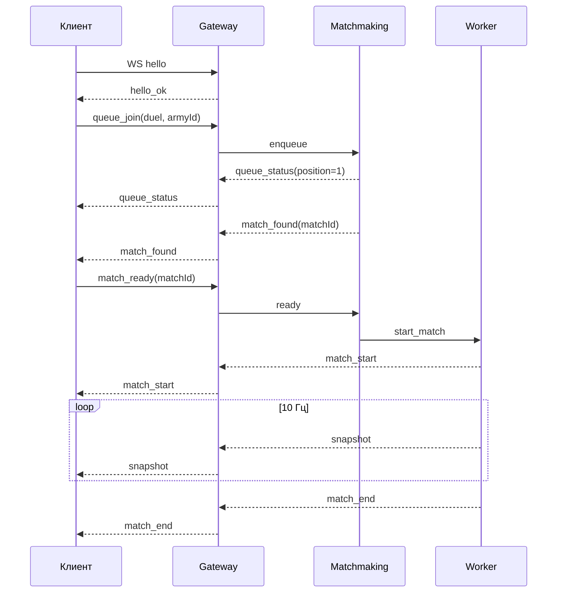

# 08. Сетевой протокол

## 8.1. Общие принципы

- REST/HTTPS — для аккаунта, контента, лаборатории, армий, истории, реплеев.
- WebSocket/WSS — для лобби, матча, зрительского режима, чата.
- JSON — для REST и лобби-сообщений.
- FlatBuffers — для снапшотов, ключевых кадров и реплеев.
- Все схемы версионируются; клиент и сервер обмениваются `protocolVersion`.
- Сервер авторитетен; клиент не отправляет игровые команды после старта.
- Все сообщения идемпотентны по `requestId`, где это применимо.

## 8.2. Версионирование

| Параметр | Формат | Пример |
|---|---|---|
| `protocolVersion` | semver | `1.4.0` |
| `schemaHash` | 8 hex | `a1b2c3d4` |
| `catalogVersion` | date-based | `2026.11.1` |
| `rulesetVersion` | semver | `1.0.0` |
| `replayVersion` | int | `1` |

Правила:

- Minor-версия добавляет поля, не ломая старых клиентов.
- Major-версия требует обновления клиента.
- Сервер поддерживает текущую и предыдущую major-версию в течение 30 дней.
- При несовпадении `rulesetVersion` матч не стартует; клиент предлагает обновить страницу.
- Реплей запускается только на той же версии правил; старые версии хранятся на сервере.

## 8.3. REST API

Базовый путь: `/api/v1`.

### 8.3.1. Аутентификация

| Метод | Путь | Тело | Ответ |
|---|---|---|---|
| POST | `/auth/register` | email, password, nickname, locale | user, tokens |
| POST | `/auth/login` | email, password | tokens |
| POST | `/auth/refresh` | refreshToken | tokens |
| POST | `/auth/logout` | refreshToken | 204 |
| POST | `/auth/verify-email` | token | 204 |
| POST | `/auth/request-reset` | email | 202 |
| POST | `/auth/reset-password` | token, password | 204 |
| GET | `/auth/oauth/{provider}/start` | — | redirect |
| GET | `/auth/oauth/{provider}/callback` | code, state | redirect + tokens |
| POST | `/ws/ticket` | — | одноразовый тикет для WebSocket |

Токены:

```json
{
  "accessToken": "eyJ...",
  "refreshToken": "rt_...",
  "expiresIn": 900,
  "tokenType": "Bearer"
}
```

### 8.3.2. Профиль

| Метод | Путь | Назначение |
|---|---|---|
| GET | `/me` | Профиль, настройки, валюта |
| PATCH | `/me` | Ник, аватар, настройки |
| GET | `/me/stats` | Статистика, рейтинг, история |
| GET | `/users/{id}` | Публичный профиль |
| DELETE | `/me` | Запрос удаления аккаунта |

### 8.3.3. Контент

| Метод | Путь | Назначение |
|---|---|---|
| GET | `/catalog` | Каталог органов, шаблонов, пресетов |
| GET | `/catalog/version` | Текущая версия и хеш |
| GET | `/maps` | Список карт |
| GET | `/rulesets/current` | Текущие правила и лимиты |

Каталог кэшируется на клиенте по `ETag` и версии.

### 8.3.4. Существа

| Метод | Путь | Назначение |
|---|---|---|
| GET | `/creatures` | Список существ |
| POST | `/creatures/validate` | Валидация без сохранения |
| POST | `/creatures` | Создание версии |
| GET | `/creatures/{id}` | Существо и версии |
| POST | `/creatures/{id}/versions` | Новая версия |
| DELETE | `/creatures/{id}` | Мягкое удаление |
| POST | `/creatures/import` | Импорт из кода |
| GET | `/creatures/{id}/export` | Экспорт в код |

### 8.3.5. Армии

| Метод | Путь | Назначение |
|---|---|---|
| GET | `/armies` | Список армий |
| POST | `/armies` | Создание |
| PUT | `/armies/{id}` | Обновление |
| DELETE | `/armies/{id}` | Удаление |
| POST | `/armies/{id}/validate` | Проверка состава и расстановки |

### 8.3.6. Матчи и реплеи

| Метод | Путь | Назначение |
|---|---|---|
| GET | `/matches` | История матчей |
| GET | `/matches/{id}` | Детали матча |
| GET | `/matches/{id}/result` | Результат и статистика |
| GET | `/replays/{id}` | Метаданные реплея |
| GET | `/replays/{id}/file` | Файл реплея (range) |
| POST | `/replays/{id}/share` | Публичная ссылка |
| DELETE | `/replays/{id}/share` | Отзыв ссылки |
| GET | `/leaderboard` | Лидерборд |

### 8.3.7. Экономика

| Метод | Путь | Назначение |
|---|---|---|
| GET | `/wallet` | Баланс и история |
| POST | `/store/purchase` | Покупка (идемпотентно) |
| GET | `/store/items` | Косметика |
| POST | `/rewards/claim` | Получение награды |

### 8.3.8. Социальное

| Метод | Путь | Назначение |
|---|---|---|
| POST | `/reports` | Жалоба |
| GET | `/reports/{id}` | Статус |
| POST | `/users/{id}/block` | Блокировка |
| DELETE | `/users/{id}/block` | Разблокировка |
| GET | `/friends` | Друзья |

### 8.3.9. Соглашения REST

- Пагинация: `?limit=20&cursor=...`, ответ `{items, nextCursor}`.
- Сортировка: `?sort=createdAt&order=desc`.
- Ошибки: единый формат из раздела 4.3.3.
- Идемпотентность: заголовок `Idempotency-Key` для POST, меняющих экономику.
- Кэш: `ETag`, `Cache-Control` для каталога и карт.
- Лимиты: `429` с `Retry-After`.

## 8.4. WebSocket

### 8.4.1. Подключение

Клиент получает одноразовый тикет:

```
POST /api/v1/ws/ticket
Authorization: Bearer <accessToken>
→ {"ticket": "wt_...", "expiresIn": 30}
```

Затем подключается:

```
wss://api.iceja.example/ws?ticket=wt_...&protocol=1.4.0
```

- Тикет живёт 30 секунд, одноразовый, привязан к пользователю и IP-хешу.
- Access-токен не передаётся в URL и не попадает в логи прокси.
- При истечении токена клиент получает новый тикет по REST и переподключается.
- Сервер отправляет `hello_ok` с `sessionId`, `serverTime`, `protocolVersion`.
- Ping/pong: сервер каждые 20 с, клиент отвечает; таймаут 60 с.

### 8.4.2. Формат сообщений

```json
{
  "type": "queue_join",
  "requestId": "01J...",
  "ts": 1763000000000,
  "payload": {}
}
```

- `type` — строка, стабильная.
- `requestId` — UUIDv7, для ответа.
- `ts` — клиентское время, не влияет на симуляцию.
- `payload` — объект, схема зависит от типа.

### 8.4.3. Клиент → сервер

| Тип | Payload | Назначение |
|---|---|---|
| `hello` | protocolVersion, locale | Начало сессии |
| `queue_join` | mode, armyId | Встать в очередь |
| `queue_leave` | — | Покинуть очередь |
| `match_ready` | matchId, armyHash | Подтвердить матч |
| `match_cancel` | matchId | Отменить до старта |
| `spectate_join` | matchId | Смотреть матч |
| `spectate_leave` | matchId | Прекратить |
| `chat_send` | matchId, text | Сообщение |
| `emote_send` | matchId, emoteId | Эмоция |
| `replay_control` | replayId, action, position | Управление реплеем |
| `ping` | — | Проверка связи |

**Запрещено:** любые сообщения, влияющие на симуляцию (`move`, `attack`, `spawn`, `use`). Сервер отвечает `error` с кодом `COMMAND_NOT_ALLOWED`.

### 8.4.4. Сервер → клиент

| Тип | Payload | Назначение |
|---|---|---|
| `hello_ok` | sessionId, serverTime, protocolVersion | Подтверждение |
| `queue_status` | position, estimatedWait, mode | Статус очереди |
| `match_found` | matchId, opponent, confirmDeadline | Матч найден |
| `match_start` | matchId, seed, map, players, ruleset, genomes[], snapshot | Старт |
| `snapshot` | binary | Состояние |
| `event_batch` | events[] | События |
| `match_resume` | matchId, keyframe, tick | Реконнект |
| `match_end` | result, stats, replayId | Финал |
| `chat_message` | userId, nickname, text, ts | Чат |
| `emote` | userId, emoteId | Эмоция |
| `replay_meta` | replayId, duration, players | Реплей |
| `replay_chunk` | offset, bytes | Реплей |
| `error` | code, message, details | Ошибка |
| `pong` | — | Ответ |

### 8.4.5. Бинарные сообщения

- Снапшоты и реплеи передаются бинарными WebSocket-фреймами.
- Первый байт — тип: `0x01` snapshot, `0x02` keyframe, `0x03` replay chunk.
- Далее — FlatBuffers-буфер.
- JSON-сообщения — текстовые фреймы.
- Максимальный размер фрейма: 1 МБ.
- Сжатие: permessage-deflate для JSON, не для FlatBuffers (уже компактно).

## 8.5. Снапшоты

### 8.5.1. Схема

```fbs
namespace iceja.snapshot;

table Vec2 { x:int; y:int; }
table Entity {
  id:uint;
  kind:ubyte;
  owner:ubyte;
  x:int;
  y:int;
  angle:ushort;
  hp:ushort;
  maxHp:ushort;
  energy:ushort;
  flags:uint;
  state:ubyte;
  targetId:uint;
  genomeId:uint;
}
table Projectile {
  id:uint;
  owner:ubyte;
  x:int;
  y:int;
  angle:ushort;
  kind:ubyte;
  ttl:ushort;
}
table Hive {
  owner:ubyte;
  x:int;
  y:int;
  hp:ushort;
  maxHp:ushort;
  flags:uint;
}
table Snapshot {
  tick:uint;
  serverTimeMs:ulong;
  matchId:string;
  entities:[Entity];
  projectiles:[Projectile];
  hives:[Hive];
  scores:[uint];
  flags:uint;
  checksum:ulong;
}
root_type Snapshot;
```

`genomeId` в снапшоте — не UUID, а локальный индекс (0…N) в таблице `genomes[]`, которая передаётся в `match_start`. Это экономит трафик и позволяет клиенту сопоставить существо с геномом без запроса к REST.

Поле `state` — перечисление:

| Код | Состояние |
|---|---|
| 0 | `IDLE` |
| 1 | `MOVING` |
| 2 | `ATTACKING` |
| 3 | `HARVESTING` |
| 4 | `FLEEING` |
| 5 | `STUNNED` |
| 6 | `BURROWED` |
| 7 | `DEAD` |

### 8.5.2. Квантование

| Поле | Тип | Точность |
|---|---|---|
| `x`, `y` | int32, мм | 1 мм |
| `angle` | uint16 | 1/65536 оборота |
| `hp`, `maxHp` | uint16 | 1 единица |
| `energy` | uint16 | 1 единица |
| `tick` | uint32 | 1 тик |
| `ttl` | uint16 | 1 тик |

### 8.5.3. Частота и дельта

- Снапшот каждые 3 тика (10 Гц).
- Ключевой кадр каждые 30 тиков (1 Гц).
- Дельта-снапшот содержит только изменившиеся поля; для простоты MVP допускается полный снапшот.
- Клиент хранит последний ключевой кадр и применяет дельты.
- При потере пакета клиент запрашивает ключевой кадр (`resync`).

### 8.5.4. Флаги сущности

| Бит | Значение |
|---|---|
| 0 | alive |
| 1 | moving |
| 2 | attacking |
| 3 | stunned |
| 4 | burning |
| 5 | burrowed |
| 6 | flying |
| 7 | selected |
| 8 | underAttack |
| 9 | fleeing |
| 10 | healing |

### 8.5.5. Оценка размера

- Существо: ~28 байт + оверхед FlatBuffers.
- 80 существ: ~2.5 КБ.
- Снаряды: ~16 байт × до 100 = 1.6 КБ.
- Итого пик: ~6 КБ на снапшот, ~60 КБ/с в пике, обычно ≤ 30 КБ/с.

## 8.6. События

### 8.6.1. Схема

```fbs
namespace iceja.event;

table GameEvent {
  id:uint;
  tick:uint;
  type:ubyte;
  sourceId:uint;
  targetId:uint;
  x:int;
  y:int;
  value:int;
  flags:uint;
  text:string;
}
table EventBatch {
  matchId:string;
  tick:uint;
  events:[GameEvent];
}
root_type EventBatch;
```

### 8.6.2. Типы

| Код | Тип | `value` |
|---|---|---|
| 1 | `SPAWN` | genomeId |
| 2 | `DEATH` | cause |
| 3 | `ATTACK` | weaponId |
| 4 | `HIT` | damage |
| 5 | `MISS` | weaponId |
| 6 | `HEAL` | amount |
| 7 | `STATUS` | statusId |
| 8 | `OBJECTIVE` | hp |
| 9 | `RESOURCE` | amount |
| 10 | `ABILITY` | abilityId |
| 11 | `MATCH_END` | winner |
| 12 | `CHAT` | — |

- События не являются авторитетными для симуляции.
- Клиент может отбросить события при перегрузке, кроме `MATCH_END`.
- `CHAT` не входит в симуляцию и не влияет на детерминизм.

## 8.7. Реплеи

### 8.7.1. Формат `.iceja-replay`

```text
Header (FlatBuffers)
  replayVersion
  matchId
  createdAt
  rulesetVersion
  catalogVersion
  mapId
  seed[16]
  players[2] { userId, nickname, armyHash, genomeHashes[] }
  durationTicks
  result
Keyframes[]
  tick, offset, length
Frames[]
  tick, offset, length
Events[]
  tick, offset, length
Footer
  checksum
  signature (Ed25519)
```

### 8.7.2. Хранение

- Файл сжимается zstd (уровень 10).
- Метаданные — в PostgreSQL, файл — в S3.
- Публичная ссылка: `https://iceja.example/r/{shareId}`.
- `shareId` — случайный, 12 символов, не содержит `matchId`.
- Доступ: участники всегда; зрители — если включён шаринг.

### 8.7.3. Воспроизведение

- Клиент может проигрывать снапшоты (быстро) или ресимулировать (точно).
- Для перемотки используются ключевые кадры.
- При несовпадении версии — ошибка `REPLAY_VERSION_MISMATCH`.
- Сервер может пересчитать реплей и сравнить финальный хеш.

### 8.7.4. Подпись

- Сервер подписывает финальный хеш и результат.
- Клиент может проверить подпись по публичному ключу.
- Это защита от подделки результатов, а не от подделки клиента.

## 8.8. Коды ошибок

| Код | HTTP/WS | Описание |
|---|---|---|
| `UNAUTHORIZED` | 401 | Нет токена |
| `TOKEN_EXPIRED` | 401 | Истёк access |
| `FORBIDDEN` | 403 | Нет прав |
| `NOT_FOUND` | 404 | Не найдено |
| `VALIDATION_FAILED` | 422 | Ошибка схемы |
| `GENOME_INVALID` | 422 | Геном невалиден |
| `GENOME_BUDGET_EXCEEDED` | 422 | Превышен бюджет |
| `ARMY_INVALID` | 422 | Армия невалидна |
| `RULESET_MISMATCH` | 409 | Версия правил |
| `CATALOG_MISMATCH` | 409 | Версия каталога |
| `QUEUE_FULL` | 429 | Очередь переполнена |
| `RATE_LIMITED` | 429 | Лимит |
| `MATCH_NOT_FOUND` | 404 | Матч не найден |
| `MATCH_ENDED` | 409 | Матч завершён |
| `MATCH_FULL` | 409 | Нет зрительских слотов |
| `COMMAND_NOT_ALLOWED` | 403 | Попытка управления |
| `REPLAY_VERSION_MISMATCH` | 409 | Версия реплея |
| `INTERNAL` | 500 | Внутренняя ошибка |
| `DEPENDENCY_UNAVAILABLE` | 503 | Зависимость недоступна |

## 8.9. Лимиты

| Ресурс | Лимит |
|---|---|
| REST на пользователя | 60/мин, burst 20 |
| REST на IP | 300/мин |
| WS сообщений | 20/мин |
| Размер REST тела | 256 КБ |
| Размер WS JSON | 64 КБ |
| Размер WS binary | 1 МБ |
| Одновременных WS на пользователя | 3 |
| Зрителей на матч | 50 (MVP) |
| Чат | 1 сообщение / 2 с, 200 символов |

## 8.10. Пример последовательности



## 8.11. Совместимость и миграции

- Новые поля в JSON игнорируются старыми клиентами.
- Удаление поля — только в major-версии.
- FlatBuffers: новые поля добавляются в конец таблицы; старые клиенты читают по `vtable`.
- При старте клиент получает `minSupportedProtocol`; если его версия ниже — экран обновления.
- Сервер логирует версии клиентов для анализа.

## 8.12. Безопасность протокола

- WSS обязателен, кроме localhost.
- Проверка Origin для WebSocket.
- В URL передаётся только одноразовый тикет; access-токен остаётся в заголовке REST.
- Все бинарные сообщения проверяются по размеру и схеме.
- Неизвестные типы игнорируются с логом, но не роняют соединение.
- Чат проходит фильтр и rate limit.
- Replay share ID не позволяет перебирать матчи.
