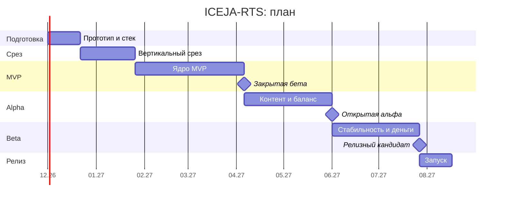

# 13. План разработки

## 13.1. Подход

- Итеративная разработка короткими циклами (2 недели).
- Сначала — **ядро симуляции и детерминизм**, затем контент и клиент.
- Каждая фаза заканчивается играбельным результатом.
- Баланс и контент идут параллельно с разработкой, а не после.
- Рискованные гипотезы проверяются прототипами до полной реализации.

## 13.2. Фазы

### Фаза 0. Подготовка (2–3 недели)

**Цель:** снять неопределённость по стеку и детерминизму.

Задачи:

- Прототип `sim-core`: 20 существ, 2 типа оружия, движение, урон.
- Проверка детерминизма на x64 и ARM.
- Прототип снапшота FlatBuffers + PixiJS-рендер 100 существ.
- Выбор арт-стиля, 5 концептов существ.
- Настройка репозитория, CI, линтеров, Docker Compose.
- Схема БД v0, каркас Ktor.
- Тест производительности тика.

**Выход:** демо «две армии бегут и дерутся», 60 FPS в браузере, одинаковый хеш на двух машинах.

### Фаза 1. Вертикальный срез (4–5 недель)

**Цель:** полный цикл «создал → выпустил → посмотрел» на одном существе.

Задачи:

- Конструктор v1: 10 органов, сокеты, бюджет, валидация.
- Поведение v1: 8 узлов, 2 пресета.
- Полигон: матч против манекена.
- Матч 1×1 без матчмейкинга (по коду комнаты).
- Зрительский режим v1: камера, HP-бары, инспектор.
- Сохранение генома и армии.
- Локализация RU/EN.

**Выход:** можно собрать тварь, запустить бой и посмотреть результат.

### Фаза 2. MVP (8–10 недель)

**Цель:** публично играбельная версия.

Must-функции:

- 30+ органов, 6 шасси, 8 пресетов поведения.
- 3 карты, 1 режим «Дуэль».
- Армия до 40 существ, бюджет 6000 BM.
- Матчмейкинг 1×1, Glicko-2, боты.
- Полноценный зрительский режим.
- Реплеи и базовый разбор.
- Регистрация, профиль, статистика.
- Ежедневные задания, мягкая валюта.
- Модерация ников и чата.
- Админ-панель v1.
- Мониторинг, алерты, бэкапы.
- 10 000 матчей в golden-тестах.

**Выход:** закрытая бета на 500–1 000 игроков.

### Фаза 3. Alpha (6–8 недель)

**Цель:** удержание и баланс.

Задачи:

- 50+ органов, 4 архетипа, 10 пресетов.
- 5 карт, режимы «Осада» и «Выживание».
- Прогрессия до 30 уровня.
- Коллекция, косметика, магазин.
- Реплеи: шаринг, тепловые карты, разбор.
- Турнирный режим v1.
- AI-турниры для баланса.
- Оптимизация клиента и сервера.
- Расширенная аналитика.

**Выход:** открытая альфа, 5 000+ игроков, D7 ≥ 12%.

### Фаза 4. Beta (6–8 недель)

**Цель:** стабильность и монетизация.

Задачи:

- Сезонный пропуск, косметика.
- 8 карт, 3 режима, турниры.
- Полная модерация и поддержка.
- Нагрузочное тестирование 20 000 CCU.
- Пентест.
- Локализация на 2–4 языка (Should).
- PWA, улучшение загрузки.
- Балансный патч по данным.
- Юридические документы.

**Выход:** релизный кандидат.

### Фаза 5. Релиз (2–4 недели)

- Канареечный запуск.
- Мониторинг 24/7.
- Быстрые хотфиксы.
- Маркетинговый запуск.
- Постмортем через 2 недели.

## 13.3. Дорожная карта (ориентир)

Даты условны и зависят от старта финансирования и команды.

## 13.4. Команда

### 13.4.1. Минимальная команда MVP (5–6 FTE)

| Роль | Занятость | Ответственность |
|---|---|---|
| Backend Kotlin | 1.0 | API, симуляция, БД, инфраструктура |
| Frontend TypeScript | 1.0 | Клиент, конструктор, зритель |
| Гейм-дизайнер / баланс | 1.0 | Правила, органы, поведение, баланс |
| Художник / technical artist | 0.5–1.0 | Спрайты, UI, эффекты, стиль |
| QA | 0.5 | Тесты, приёмка, баг-репорты |
| DevOps | 0.5 | CI/CD, K8s, мониторинг |
| Продакт/продюсер | 0.5 | Приоритеты, коммуникация |

### 13.4.2. Команда релиза (8–10 FTE)

Добавляются:

- второй backend-разработчик;
- второй frontend-разработчик;
- аниматор/VFX;
- комьюнити-менеджер/модератор;
- аналитик данных.

### 13.4.3. Внешние подрядчики

- Звук и музыка.
- Локализация.
- Пентест.
- Юридические услуги.
- Маркетинг.

## 13.5. Оценка трудозатрат

| Блок | Человеко-недели |
|---|---|
| Симуляция и детерминизм | 16–20 |
| Сервер API и данные | 18–22 |
| Матчмейкинг, рейтинг | 6–8 |
| Клиент: каркас и сеть | 8–10 |
| Клиент: конструктор | 14–18 |
| Клиент: поведение | 10–12 |
| Клиент: зритель и реплеи | 10–14 |
| Арт и анимация | 20–30 |
| Контент и баланс | 16–24 |
| QA и автоматизация | 10–14 |
| DevOps и инфраструктура | 8–10 |
| Модерация и поддержка | 6–8 |
| **Итого** | **142–190** |

При команде 6 FTE: ~6–8 месяцев до MVP, 10–12 месяцев до релиза.

## 13.6. MVP: точный объём

### 13.6.1. Входит

- 1 режим (Дуэль).
- 3 карты.
- 30 органов, 6 шасси.
- 8 пресетов поведения, 20 узлов.
- Конструктор с валидацией и бюджетом.
- Армия до 40 существ.
- Матчмейкинг 1×1 + боты.
- Зрительский режим.
- Реплеи (просмотр).
- Аккаунты, профиль, статистика.
- Ежедневные задания.
- Модерация ников.
- Админ-панель.
- RU/EN.
- Мониторинг, бэкапы.

### 13.6.2. Не входит

- Осада, выживание, турниры.
- Магазин и премиум-валюта.
- Косметика.
- Друзья.
- Пользовательские карты.
- Мобильные браузеры.
- Голосовой чат.
- Экспорт видео.
- Публичные геномы.

## 13.7. Зависимости

| Зависимость | Влияние | Владелец |
|---|---|---|
| Арт-контент | Без спрайтов нет конструктора | арт-директор |
| Балансные данные | Без цифр нет матчей | гейм-дизайн |
| Инфраструктура | Без БД и Redis нет беты | DevOps |
| Юридические документы | Без них нет релиза | продакт |
| Платёжный провайдер | Влияет на монетизацию | продакт |
| Модерация | Влияет на публичный запуск | комьюнити |

## 13.8. Риски проекта

| Риск | Вероятность | Влияние | Митигация |
|---|---|---|---|
| Детерминизм не достигается | Средняя | Критическое | Ранний прототип, целочисленная математика, харнесс |
| Конструктор слишком сложен | Высокая | Высокое | Тесты на новичках, шаблоны, упрощение |
| Баланс требует много итераций | Высокая | Высокое | AI-турниры, малые патчи, данные |
| Клиент тормозит в браузере | Средняя | Высокое | Ранний прототип, бюджеты, деградация |
| Мало игроков для очереди | Средняя | Высокое | Боты, один регион, маркетинг |
| Стоимость инфраструктуры | Средняя | Среднее | Лимиты, автоскейл, мониторинг |
| Токсичность | Высокая | Среднее | Модерация, фильтры |
| Юридические ограничения | Низкая | Высокое | Консультация, возрастной рейтинг |
| Выгорание команды | Средняя | Высокое | Реалистичный план, вехи, отпуска |
| Срыв сроков | Высокая | Среднее | MVP-фокус, буфер 20% |

## 13.9. Вехи и критерии

| Веха | Критерий |
|---|---|
| M0. Прототип | 2 армии, детерминизм, 60 FPS |
| M1. Срез | Полный цикл на 1 существе |
| M2. MVP | 500 игроков, D1 ≥ 30%, tick p95 ≤ 8 мс |
| M3. Alpha | 5 000 игроков, D7 ≥ 12%, 3 режима |
| M4. Beta | 20 000 CCU, пентест, монетизация |
| M5. Release | 99.9% API, crash-free 99.5%, поддержка |

## 13.10. Бюджет (ориентир)

| Статья | MVP | Релиз/год |
|---|---|---|
| Команда | 6 FTE × 6 мес | 9 FTE × 12 мес |
| Арт и звук | 15–25% | 15–25% |
| Инфраструктура | $500–1 500/мес | $3 000–10 000/мес |
| Маркетинг | — | 20–40% бюджета |
| Юридические | $2–5 тыс. | $5–15 тыс. |
| Пентест | — | $5–15 тыс. |

Точные суммы зависят от региона и модели найма.

## 13.11. Процесс разработки

- Двухнедельные спринты.
- Планирование, дейли, ретро.
- Задачи в трекере с оценками.
- Код-ревью обязательно.
- CI: линтеры, тесты, сборка, детерминизм.
- Staging-деплой на каждый merge в main.
- Релиз — по готовности, не по дате.
- Feature flags для рискованных функций.
- Документация обновляется вместе с кодом.

## 13.12. Метрики разработки

- Velocity (story points).
- Lead time.
- Bug rate.
- Покрытие тестами.
- Время на ревью.
- Количество инцидентов.
- Доля автоматизированных тестов.

## 13.13. После релиза

- Сезоны каждые 8 недель.
- Балансные патчи раз в 2 недели.
- Контент: 5–10 органов в сезон.
- Новые режимы: осада, турниры, кооператив.
- Пользовательские карты и моды — по спросу.
- Мобильный зритель — при подтверждённом спросе.
- Интеграция со стриминговыми платформами.

## 13.14. Критерии остановки/пивота

Проект требует пересмотра, если:

- Детерминизм не достигается за 2 месяца.
- Новички не проходят цикл «тварь → матч» за 20 минут.
- Зрители не понимают бой после 3 матчей.
- D7 ниже 8% после альфы.
- Стоимость матча превышает бюджет в 3 раза.
- Баланс не стабилизируется за 3 итерации.

Решение принимается продактом, техническим лидом и гейм-дизайном на основе данных, а не мнений.
